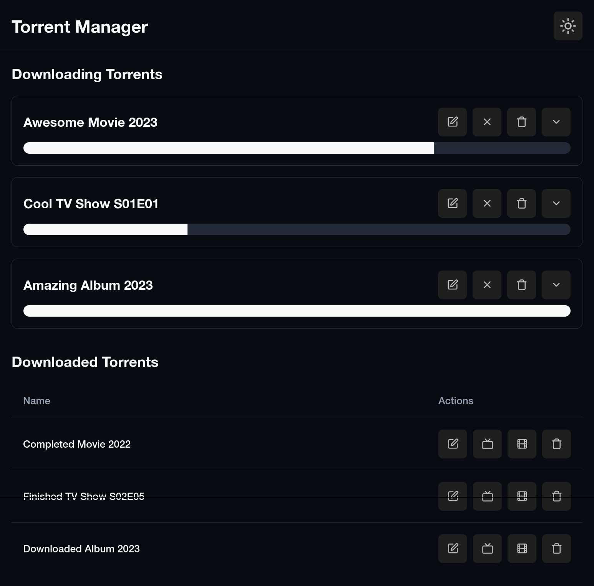
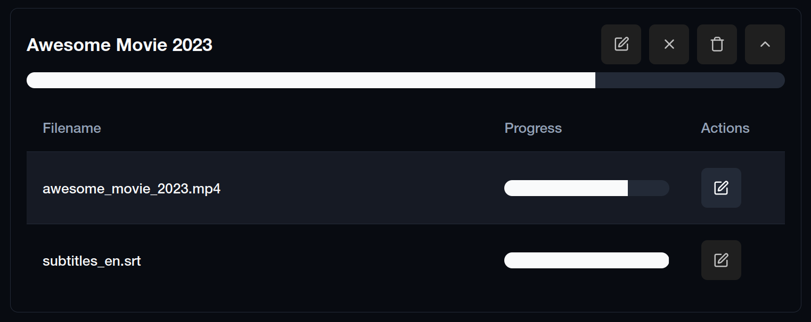
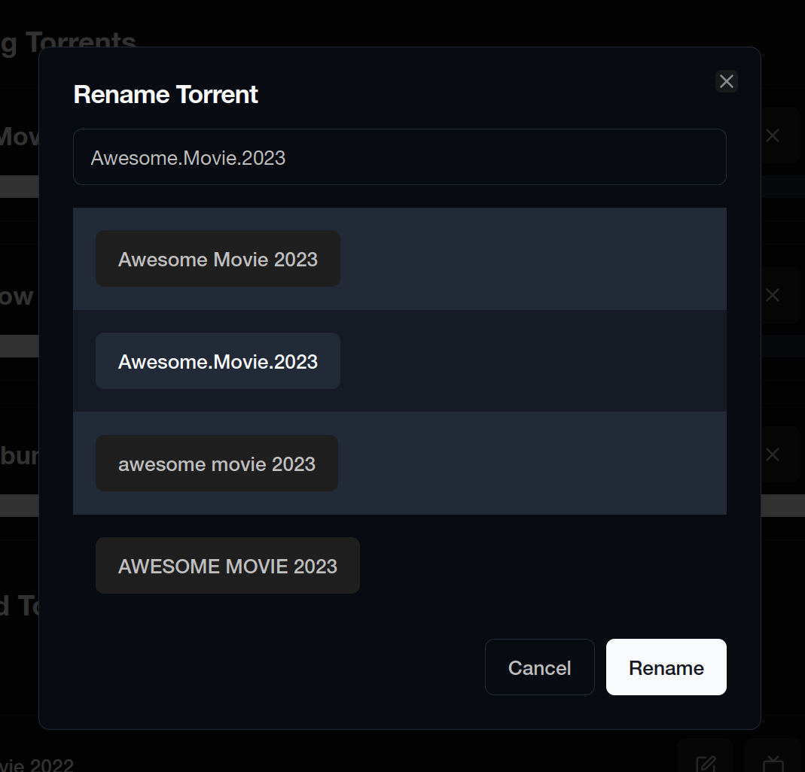

# TorrentBox

Couch level management of torrents via Transmission, the focus is on file naming and moving to the right place in your media archive.  Transmission and your preferred web interface aren't replaced,  TorrentBox is just a pleasant place to deal with the

## Install/run

Clone this repo and run:

```sh
pnpm install
vite build
bin/service
```



View the torrent files



You can the rename torrent files and AI will suggest ideas, it'll try to remove crud from the filename.



## Todo

- Implement the service in Rust with Axum.
- Update REAME.md images to showcase the newer ui.
- Dockerfile to package up the ui, server, a transmission instance and transmissionic web view.
